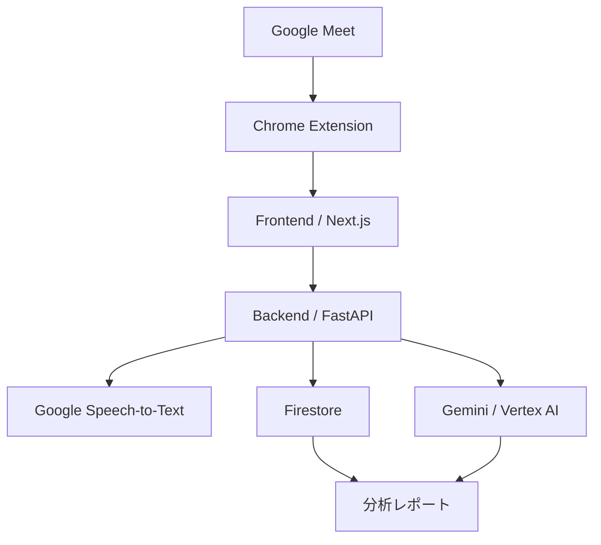

# Mimamori — AIなりすまし検知支援システム

**チーム名：WaiWaiWaiWai!!!!**

## 1. 作品概要

Mimamoriは、オンライン通話におけるAI合成音声やディープフェイクを利用したなりすましのリスクを検知・可視化する支援システムです。

AI技術の進歩により、音声や映像を使ったなりすましのリスクが高まっています。

本システムは、通話中の音声や会話内容を分析し、不審な発言や違和感のあるやり取りを検知することで、利用者が詐欺やなりすましに気付くための判断材料を提供します。

単に警告を出すだけでなく、**なぜ不審と判断したのかという理由も提示すること**を重視しています。

## 2. 主な機能

- **音声取得**：Google Meetの通話音声をChrome拡張機能から取得
- **文字起こし**：Google Cloud Speech-to-Textを利用した音声認識
- **AI分析**：Geminiによる会話内容の不審性分析
- **リスク可視化**：分析結果に基づくリスクレベルと判断理由の提示
- **レポート表示**：通話・分析セッションの結果をWeb画面で確認
- **分析結果保存**：Firestoreを利用した分析結果の保存

※ 検知は実験段階です。AIの判定はなりすましの確定的な証拠ではなく、人による確認を支援するための参考情報です。

## 3. デモ

**Webアプリケーション**

https://waiwaiwaiwai.web.app

**Backend**

https://detector-backend-vaggox657a-an.a.run.app

**Frontend**

https://detector-frontend-vaggox657a-an.a.run.app

## 4. システム構成



### データ処理の流れ

1. Chrome拡張機能から通話音声を取得
2. Frontend経由でBackendへ分析リクエストを送信
3. Speech-to-Textで音声を文字起こし
4. Geminiで発言内容を分析
5. 分析結果をFirestoreに保存
6. Web画面で分析結果・レポートを確認

## 5. 使用技術

| 分類 | 技術 |
|---|---|
| フロントエンド | Next.js / TypeScript |
| 状態管理 | Zustand |
| Chrome拡張機能 | Chrome Extension Manifest V3 |
| バックエンド | Python / FastAPI |
| AI分析 | Gemini 3.5 Flash / Vertex AI |
| 音声認識 | Google Cloud Speech-to-Text |
| データ保存 | Cloud Firestore |
| アプリケーション実行環境 | Google Cloud Run |
| ホスティング | Firebase Hosting |
| 認証情報管理 | Google Cloud Secret Manager |

## 6. ディレクトリ構成

```text
.
├── backend/       # FastAPI・AI分析・音声認識
├── frontend/      # Next.js Webアプリケーション
├── extension/     # Google Meet向けChrome拡張機能
├── infra/         # GCPインフラ・デプロイ設定
├── docs/          # 設計書・技術選定・検証資料
├── samples/       # 分析用サンプルデータ
└── scripts/       # 検証・評価用スクリプト
```

## 7. ローカル環境での起動

### 必要環境

- Python 3.12
- Node.js 22
- npm
- Google Chrome

### Backend

```bash
cd backend

python3.12 -m venv .venv
source .venv/bin/activate

pip install -r requirements-dev.txt

uvicorn app.main:app --reload --port 8080
```

### Frontend

```bash
cd frontend

npm ci
npm run dev
```

### Chrome拡張機能

```bash
cd extension

npm ci
npm run build
```

ビルド後、Chromeで `chrome://extensions` を開き、デベロッパーモードを有効にして `extension/dist` を読み込んでください。

### モックモード

Geminiの認証情報がない場合は、`.env.example` を参考に `.env` を作成し、`DETECTOR_BACKEND=mock` に設定することでモック検知器を利用できます。

本番環境の認証情報はローカル環境へコピーせず、Google Cloud Secret Managerで管理してください。

## 8. 設計・技術資料

- [システムアーキテクチャ](docs/architecture.md)
- [Google技術を採用した理由](docs/why-google-tech.md)
- [技術選定](docs/tech-selection.md)
- [API仕様](docs/api.md)
- [API契約](docs/api-contract.md)
- [AI分析仕様](docs/analyze-gemini.md)
- [音声取得設計](docs/audio-capture.md)
- [費用見積もり](docs/cost-estimate.md)
- [プライバシー・同意に関する方針案](docs/privacy-consent-policy-draft.md)

## 9. 制限事項・今後の課題

本作品はハッカソンにおけるプロトタイプです。

- 不審な発言の検知精度は継続的な改善が必要です。
- AIの判定には誤検知・検知漏れが発生する可能性があります。
- 実際の通話から文字起こし、AI分析、Firestore保存、レポート表示までの一連のE2E動作は未検証です。
- 音声・映像を取得する際には、関係者の同意と適切なデータ管理が必要です。
- AIの判定のみで本人確認や不正行為の断定を行うことは想定していません。

## 10. チーム

**WaiWaiWaiWai!!!!**

DevFest Hackathon 2026

## License

MIT License

