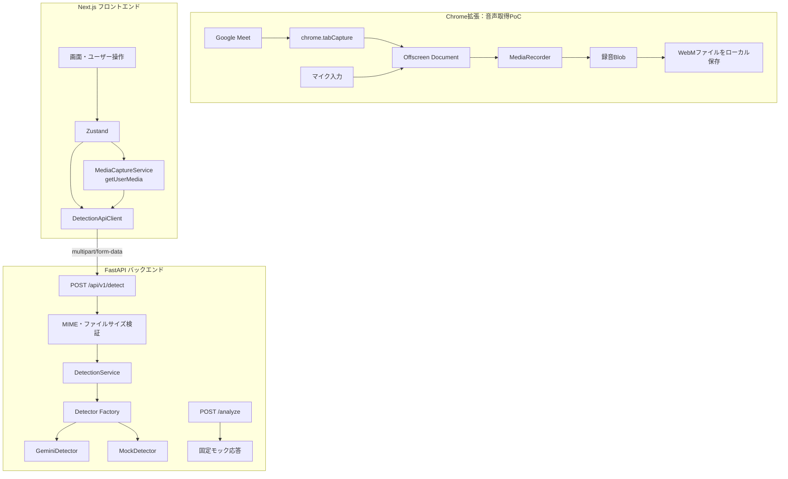
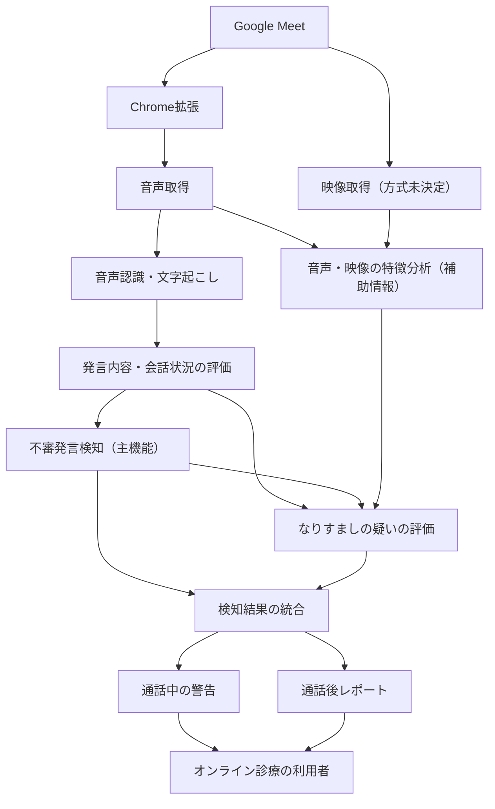

# システムアーキテクチャ

## 1. 目的

本システムは、オンライン診療中の会話を分析し、不審な発言や不自然な要求を検知することを目的とする。

主機能は **不審発言検知** とする。また、発言内容や会話状況を中心に、音声・映像の不自然さも補助情報として利用し、医師や関係者へのなりすましの疑いを評価する。

なお、検知結果は疑いを示すものであり、なりすましや不正行為を確定する証拠として扱わない。

## 2. 現在の実装構成

以下は、現時点でソースコードから確認できた構成である。

### 2.1 Chrome拡張

- `chrome.tabCapture` でGoogle Meetのタブ音声を取得する。
- マイク入力とタブ音声を左右のチャンネルに分け、ステレオ音声として合成する。
- `MediaRecorder` で録音する。
- 約1秒間隔で録音チャンクを生成するが、現状はメモリ内に蓄積する。
- 録音停止後にBlobを生成し、WebMファイルとしてローカル保存する。

**現状の制約**

- 録音チャンクをバックエンドに逐次送信する処理は確認できていない。
- 音声認識・不審発言分析との接続は確認できていない。
- `tabCapture` はタブ全体の音声を取得する方式であり、参加者ごとの音声分離はできない。
- 音声取得のPoCには未検証項目が残っている。

### 2.2 フロントエンド

- Next.js / React / TypeScriptを使用する。
- Zustandで画面の検知状態を管理する。
- `MediaCaptureService` が `getUserMedia` でマイク・カメラのメディアを取得する。
- `DetectionApiClient` が `POST /api/v1/detect` にメディアを送信する。

### 2.3 バックエンド

- FastAPIでAPIを提供する。
- `POST /api/v1/detect` はアップロードされたメディアを検証し、Detectorに渡す。
- DetectorにはGeminiDetectorとMockDetectorがある。現在の設定ではデフォルトのDetectorはMockDetectorである。
- GeminiDetectorを利用するには環境設定が必要であり、実環境での利用状況は別途確認が必要。
- GeminiDetectorにはGemini APIとVertex AIの両方を利用するコードがある。ただし、実環境でVertex AIが有効になっているかは別途確認が必要。
- `POST /analyze` は発言テキスト分析用のAPIとして定義されているが、現在は固定モック応答であり、実際の発言分析は行っていない。

### 2.4 現在の実装に関する重要事項

Chrome拡張の録音処理と、Next.jsからバックエンドへのメディア分析処理は、現時点で接続が確認できていない。

また、`POST /api/v1/detect` はメディア分析APIであり、`POST /analyze` は発言テキスト分析APIである。両者は別の処理経路である。

したがって、現状はオンライン診療の会話をリアルタイムに取得・文字起こし・分析・警告する一連の処理が完成している状態ではない。

## 3. 目標アーキテクチャ

以下は、今後実現するシステムの目標構成である。未決定のサービスや技術は具体名を固定せず、処理上の役割として記載する。

### 3.1 主機能：不審発言検知

- 会話音声をテキスト化する。
- 発言内容と会話の前後関係を分析する。
- 不審な要求や誘導などの兆候を検知する。
- 検知理由と推奨される確認行動を提示する。

### 3.2 補助機能：なりすましの疑いの評価

- 不審発言の内容や会話状況を評価材料とする。
- 音声・映像の不自然さも補助情報として利用する。
- 不審発言があることだけで、なりすましと断定しない。
- 音声・映像に不自然さがある場合も、通信環境などの影響を考慮し、疑いとして扱う。

### 3.3 検知結果の提示

- 不審発言の検知結果となりすましの疑いを区別する。
- 検知理由と推奨行動を提示する。
- 利用者が本人確認や安全確認を行えるよう支援する。

## 4. 現在の実装と目標構成の差分
| 項目 | 現在の実装 | 目標構成 |
|---|---|---|
| 音声取得 | Chrome拡張の録音PoC | 会話音声を継続的に取得 |
| 音声認識 | 接続未確認 | 音声をテキスト化 |
| 不審発言検知 | 固定モックAPIのみ | 実際の発言内容を分析 |
| なりすまし評価 | 既存のメディア分析コードあり | 発言内容と音声・映像を補助情報として評価 |
| リアルタイム処理 | 未実装 | 通話中に分析・警告 |
| 結果表示 | 既存のメディア検知UI | 不審発言となりすましの疑いを区別して表示 |
| 通話後レポート | 接続・保存方式は未確定 | 検知結果を提示 |

## 5. 設計上の注意

- 現在の実装と目標構成を混同しない。
- 未決定の技術・サービスを確定事項として記載しない。
- 音声・映像・文字起こしなどのデータの保存や外部送信は、同意・プライバシー要件を確認して設計する。
- 検知結果は判断支援情報として扱い、医師や利用者による確認を前提とする。
- 実装や技術選定に変更があった場合は、本資料も更新する。
