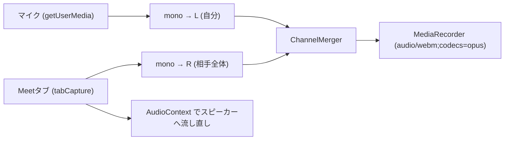

# Meet 通話の音声取得方式（Issue #4）

- 担当: なさたな, Link
- 状態: **PoC 実施中**（結果を記入したら「決定」にする）
- 関連: #5 文字起こし方式, #7 Chrome拡張の雛形, #8 Meetタブ音声の取得, #6 プライバシー・同意方針

## 1. 要件
- Google Meet の通話から、**相手の声と自分の声の両方**を取得する（会話として判定するため）
- 「誰が話したか」を区別できる（#11 で相手の発言を判定するため）
- Meet の DOM に手を加えない（Meet の UI 変更で壊れないようにするため）
- 24時間で確実に動く

## 2. 候補の比較

| 観点 | ① chrome.tabCapture | ② Meet Add-ons SDK for Web | ③ Meet Media API |
| --- | --- | --- | --- |
| 提供状況 | 安定版（MV3、Chrome 116+ で offscreen から利用可） | 一般提供 | ❌ **新規申込停止・2027年1月15日提供終了予定**（Developer Preview終了） |
| 音声を取れるか | ✅ タブの再生音を取得可能（※参加者ごとの個別トラックではなく、**タブの再生音声全体**を取得） | ❌ **音声取得不可**（Meet内にアプリUIを表示・埋め込むためのSDK） | ⚠ 取得可能だったが、サービス終了に伴い利用不可 |
| 取れる声 | 相手の声（Meetタブの再生音）のみ。Meetは自分の声を再生しないため、**マイク入力を別に取得してステレオ合成** | — | 参加者個別（利用不可） |
| ユーザー操作 | 必要（拡張アイコンのクリック等、ユーザー操作を契機に `getMediaStreamId` を実行） | アドオンの起動操作 | 管理者による事前有効化・参加者同意 |
| MV3 での実装 | SW で streamId を取得 → offscreen document で `getUserMedia` / `MediaRecorder` | Cloud プロジェクトへの登録、`createAddonSession()` | Workspace アカウント（個人Gmail不可）、DPP 参加、WebRTC クライアント自作 |
| Meet の DOM を触るか | 触らない（ブラウザAPIで完結） | 触らない（iframe 埋め込み） | 触らない |
| 実装難度（24h） | 低〜中 | 音声取得用途には不適 | 利用不可 |

出典
- chrome.tabCapture: https://developer.chrome.com/docs/extensions/reference/api/tabCapture
- offscreen: https://developer.chrome.com/docs/extensions/reference/api/offscreen
- Meet Add-ons SDK: https://developers.google.com/workspace/meet/add-ons/guides/overview
- Meet Media API (Developer Preview Discontinued): Google Meet Media API Developer Preview Program 公式アナウンス（2027年1月15日エンドポイント完全停止）

## 3. 不採用にした理由
- **② Meet Add-ons SDK**: 
  - 本SDKはMeetのサイドパネルやメインステージにWebアプリケーションの画面を表示（iframe埋め込み）するためのものであり、通話参加者の音声・映像ストリームにアクセスするAPIは提供されていないため、音声取得手段としては不適。
  - ※通話中の警告ポップアップ（#14/#15）をMeet画面内にリッチに表示するUI手段としては将来的に再検討の余地あり。
- **③ Meet Media API**: 
  - Googleより公式にDeveloper Previewの新規受付停止、および2027年1月15日でのエンドポイント完全停止が告知されている。
  - Google Workspace組織アカウントおよび管理者によるセキュリティポリシー設定が必須であり、ハッカソン環境や一般ユーザー向けMVPとして満たすべき前提条件と合致しないため不採用。

## 4. 採用方式の設計（① chrome.tabCapture ＋ マイク入力）

- **タブ再生音の取得特性**：
  `chrome.tabCapture` は参加者個別の分離トラックではなく、**Meetタブからスピーカーに出力される合成音声全体**を取得する。オンライン通話の詐欺・なりすまし検知では「相手側の発言」を一括して取得・監視できれば要件を満たすため、本方式で十分と判断。
- **ステレオ合成（L = 自分、R = 相手）**：
  マイク音声（自分）とタブ音声（相手）を Web Audio API の `ChannelMergerNode` でステレオに分離録音。話者分離の推論に頼らず、ハードウェア的に発言者を確定させる。
- **スピーカー出力の維持**：
  `tabCapture` 開始時にタブ音声の直接出力がミュートされる仕様への対策として、`AudioContext.destination` 経由でスピーカーに音声をバイパス出力。
- **権限管理**：
  offscreen document は直接マイク権限ダイアログを表示できないため、初回に `permission.html` を開いて拡張機能オリジンのマイクアクセスを許可する。
- 実装コード: [extension/](../extension/)

## 5. PoC の検証結果

| 確認項目 | 結果 | メモ |
| --- | :---: | --- |
| 拡張機能のロード・マニフェスト構文 | ✅ 確認済 | Chrome 116+ MV3、権限設定に構文エラーなし |
| Service Worker と Offscreen の連携 | ✅ 確認済 | アイコンクリック契機でのメッセージ通信・Offscreen生成/破棄ロジック |
| マイク初回権限取得フロー | ✅ 確認済 | `permission.html` を経由した拡張機能へのマイク許可 |
| 相手の声の録音（Meetタブ再生音） | ⏳ 実機検証中 | 2者通話環境での録音品質・ノイズ確認 |
| 自分の声の録音（マイク） | ⏳ 実機検証中 | マイク入力感度・エコーキャンセルの効き |
| L/R チャンネルの完全分離 | ⏳ 実機検証中 | 左ch=自分、右ch=相手に正しく分離されているか |
| 録音中の相手音声の聞き取り（バイパス） | ⏳ 実機検証中 | スピーカー/イヤホンへの再ルーティング遅延と音質 |
| スピーカー使用時の回り込み | ⏳ 実機検証中 | スピーカー使用時のマイクへの音声回り込み（デモ時はイヤホン推奨） |
| 検証環境 | — | macOS / Google Chrome 最新版（2026年11月） |

## 6. 決定と採用理由（TODO: チームの言葉で記入）

> AI の調査結果をそのまま貼らず、PoC で実際に確認したことを根拠に書く。

- 採用方式:
- 理由:
- 諦めたこと・リスク:
- 見直す条件:

## 7. プライバシー上の注意
- 録音中はタブの共有インジケータと拡張のバッジで明示される
- 相手の声を録音するため、**通話相手の同意が前提**（#6 で同意の取り方を決める）
- 調査用の録音ファイルは個人情報を含むため、リポジトリにコミットしない

