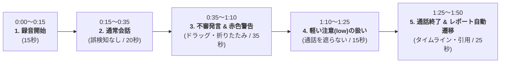

# Mimamori デモ動画台本（プレゼン埋め込み用）

- **チーム名:** WaiWaiWaiWai!!!!
- **作品名:** Mimamori（ミマモリ）
- **用途:** プレゼンテーション発表スライド内に埋め込む実機デモ動画
- **動画の役割:** 背景や挨拶はスライド側で行うため、**通話開始からレポート確認までの「実機操作・機能・UI/UXの流れ」に特化**
- **目標動画尺:** 1分40秒〜1分50秒（100秒〜110秒）

---

## 1. タイムライン構成

---

## 2. 詳細シナリオ（絵コンテ・実況ナレーション）

| 秒数 | 画面の映像・操作 | 音声・実況ナレーション | 設計意図・審査員アピール（Intent） |
|---|---|---|---|
| **0:00〜0:15** (15秒) | **ワンクリックで録音開始** ・Google Meet の通話画面 ・ツールバーの Mimamori アイコンをクリック ・ポップアップの「録音開始」を押す ・バッジが「REC」に変わりタイマーが始動 | 「実際の動作画面です。 Google Meet 通話中に拡張機能の『録音開始』をクリックすると、バックグラウンドでマイクと相手の音声を左右チャンネルに完全分離してキャプチャを開始します。」 | **【話者完全分離】** AI推論に頼らず、L=自分、R=相手として物理分離してバックエンドへ送信。 |
| **0:15〜0:35** (20秒) | **通常会話（誤検知の防止）** ・医師・患者の通常診療のやり取り 　医師：「体調はいかがですか？」 　患者：「熱や喉の痛みはありません」 ・Meet画面上部に警告は出ず、ポップアップの検知件数も「0件」のまま | 「まずは通常の診察会話です。 『体調はいかがですか』『熱や痛みはありません』といった日常的なやり取りでは、警告バナーは一切表示されず、検知件数も0件のまま静かに待機します。」 | **【誤検知の排除】** 通常の会話リズムを絶対に邪魔しない設計。 |
| **0:35〜1:10** (35秒) | **不審発言の発生 & リアルタイム赤色警告** ・相手側が発話： 　「至急、手数料として本日中に指定口座へ振り込んでください」 ・わずか4〜5秒でMeet上部に**赤色の警告バナー**が出現！ ・バナーに「理由：送金を急がせる要求」「推奨行動：公式窓口へ直接確認」が表示 ・ポップアップの検知件数が「1件」に増加 ・バナーをドラッグして画面端へ移動させたり、最小化ピルに折りたたむ操作を見せる | 「ここで、相手が『至急、手数料を口座に振り込んでください』と発言しました。 するとわずか数秒で、画面上部に赤色の警告バナーがリアルタイムに出現します。 『送金を急がせる要求』という理由と、『公式窓口へ確認してください』という具体的な推奨アクションを提示します。 診察や通話の邪魔にならないよう、バナーは自由にドラッグ移動や最小化が可能です。」 | **【リアルタイム性・UX】** 不安を煽るだけでなく、次に取るべき具体的アクションを指示。画面を遮らないドラッグ＆ドロップ。 |
| **1:10〜1:25** (15秒) | **軽い注意（low/medium）の扱い** ・相手側が発話： 　「今日中に確認のご連絡をいただけますか」 ・即時警告バナーは出ないが、ポップアップの検知件数が「2件」に増える | 「続いて『今日中に連絡をください』といった軽い注意レベルの発言です。 緊急性の高い high のみ即時警告し、medium や low は通話を遮らず、バックグラウンドで件数のみ安全にカウントします。」 | **【意図を持った設計】** すべての不審度で画面を遮ると通話が破綻するため、危険度に応じた段階的アプローチを採用。 |
| **1:25〜1:50** (25秒) | **通話終了 & 通話後レポートの自動表示** ・ポップアップの「録音停止」をクリック ・音声ファイルがローカルに自動保存される ・ブラウザが自動で `http://localhost:3000/report/[sessionId]` を新規タブで開く ・最大危険度、検出件数、通話時間が表示 ・タイムライン上のピンをクリックし、該当する不審発言カードへスムーズスクロール | 「通話が終了し『録音停止』を押すと、音声ファイルが保存されるとともに、詳細な『通話後レポート』が自動的に立ち上がります。 通話全体の危険度、どの時間帯に何が起きたかを示すタイムライン、そしてAIが根拠とした発言の引用元がすべて確認できます。 ピンをクリックすれば怪しい発言へ即座にジャンプでき、家族や病院との事後確認・証拠保全を強力に支援します。」 | **【一気通貫の完了感】** 通話中の防御から通話後の確認・保全までがシームレスに完結。 |

---

## 3. 画面録画の操作手順（収録フロー）

1. **Meet通話の準備**
   - 2台のPCまたは2つのブラウザウィンドウで Google Meet 通話に入る（一方が話者、一方が受話側画面録画）。
2. **0:00〜 録音開始**
   - 右上の Mimamori アイコンを開き、「録音開始」を押す。
3. **0:15〜 通常発話**
   - 相手役：「お変わりありませんか？ お薬はしっかり飲めていますか？」
   - 自分役：「はい、体調も落ち着いています。」
   - （画面上に何も出ないことを確認）
4. **0:35〜 不審発話**
   - 相手役：「実はシステム変更がありまして、至急、本日中に手数料5万円を指定口座へ振り込んでいただく必要があります。」
   - （約4秒後に赤色バナーが出現 → マウスでバナーを掴んで少し右や下へドラッグ → 最小化ボタンを押してピル化 → 再展開）
   - （ポップアップを開いて検知件数が「1件」になっているところを一瞬見せる）
5. **1:10〜 軽い注意発話**
   - 相手役：「念のため、本日中にお返事をいただけますか？」
   - （バナーは出ないが、ポップアップの件数が「2件」になるのを見せる）
6. **1:25〜 録音停止 & レポート確認**
   - ポップアップで「録音停止」をクリック。
   - 新しいタブで `http://localhost:3000/report/...` が自動表示される。
   - タイムラインのバーに赤いピンがあるのを見せ、ピンをクリックして下のカードにジャンプする操作を見せて録画終了。

---

## 4. 収録のポイント
- **スライドとの接続:**
  - スライド発表者：「それでは、実際の動作をご覧ください（動画再生）」→ 動画終了 → スライド発表者：「このように、リアルタイム警告と通話後レポートによって…」とスムーズに引き継げます。
- **マウスカーソルの動き:**
  - アクションが起きたとき（バナー出現、件数増加、レポート表示）は、カーソルを該当箇所に1秒静止させ、視聴者が認識しやすいようにします。
