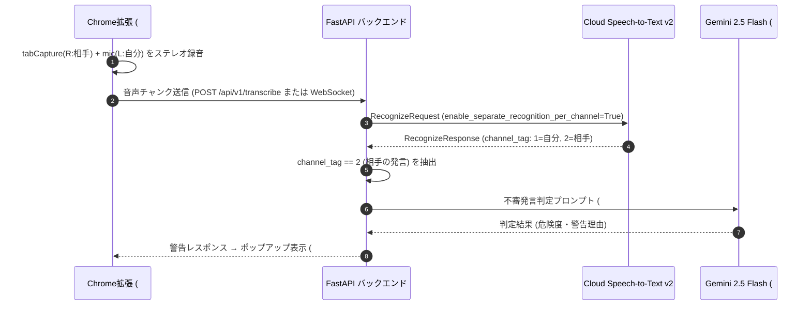

# 文字起こし（Speech-to-Text）方式の比較・決定（Issue #5）

- 担当: なさたな（Role2）
- 状態: **方式選定・検証完了（Web Speech API不可を実証、STT v2採用）**
- 関連: #4 音声取得方式, #3 コスト試算, #8 Meetタブ音声取得, #9 音声の文字起こし, #11 不審発言の判定基準

---

## 1. 目的と要件

オンライン診療における「医師・医療従事者・家族」へのなりすましや不審な金銭・情報要求を検知するため、Google Meet の通話音声をリアルタイムまたは準リアルタイムに日本語テキスト化する最適方式を決定する。

### 必須要件
1. **相手の声（Meetタブの音声）を入力できること**（最優先）
2. **「誰が話したか（自分 vs 相手）」を確実に区別できること**（#11 で相手の不審発言を判定するため）
3. **医療・金銭・本人確認に関する専門語彙の認識精度が高いこと**
4. **低遅延で警告ポップアップ（#14/#15）を出せること**
5. **24時間ハッカソンで安定して実装・動作確認できること**

---

## 2. 比較候補と検証結果

比較対象として、ブラウザ標準の **Web Speech API** と、Google Cloud の **Speech-to-Text v2** を検証。さらに最新の **Gemini 2.5 Flash（マルチモーダル音声直接入力）** も視野に入れて比較した。

### 比較一覧表

| 比較観点 | ① Web Speech API (`webkitSpeechRecognition`) | ② Google Cloud Speech-to-Text v2（★採用） | ③ Gemini 2.5 Flash 直接入力（参考） |
| :--- | :--- | :--- | :--- |
| **タブ音声（相手の声）の入力** | **❌ 不可**（ブラウザの物理マイクに固定） | **✅ 可能**（PCM / WebM / Opus チャンク送信） | **✅ 可能**（音声バイナリを直接インライン送信） |
| **話者の分離（自分 vs 相手）** | ❌ 不可（相手の声が取れない） | **◎ 完璧**（マルチチャンネル認識で L/R 完全分離） | ◯ 可能（プロンプトによる話者分離推定） |
| **日本語・医療/金銭語彙の精度** | △ 一般会話向け（辞書拡張不可） | **◎ 高精度**（最新モデル + Phrase Sets で語彙強化可） | **◎ 極めて高い**（文脈理解に基づく補正あり） |
| **遅延（発言〜確定）** | ◎ リアルタイム（ローカル完結） | **◯ 良好**（ストリーミング認識 / 数秒チャンク） | △ 1.5〜3秒（LLM推論待ち） |
| **暫定結果と確定結果** | `interimResults` で取得可 | `is_final` フラグで段階的に取得可 | 一括生成（ストリーミングはテキスト順次） |
| **コスト（#3 連動）** | 完全無料 | **月60分無料**、以降 $0.016/分（数円〜数十円） | 無料枠あり（分あたり $0.002 相当と極小） |
| **Google技術の活用度（1-a, 1-b）** | △（ブラウザ機能） | **◎ Google Cloud 中核サービス** | **◎ Google 生成AIの中核** |
| **判定** | **不採用（要件未達）** | **★ MVP採用（主軸）** | **将来構想・フォールバック** |

---

## 3. 各方式の詳細評価と不採用理由

### ❌ Web Speech API を不採用とした理由（致命的ブロッカー）
- **仕様上の制限（MediaStream入力不可）**:
  W3C および Chromium の実装仕様により、`webkitSpeechRecognition` は**端末のデフォルト物理マイク入力にハードコード**されている。
- #4 で取得に成功した `chrome.tabCapture` の MediaStream や Web Audio API の AudioNode をプログラムから音声入力として流し込む標準インターフェースが存在しない。
- したがって、「相手の声（タブ音声）」を文字起こししてなりすましを検知するという本プロダクトの前提要件を満たすことが**構造上不可能**であるため、不採用とした。

### ⭕ Google Cloud Speech-to-Text v2 を採用した理由（Own the Why）
1. **#4 のステレオ録音（L=自分, R=相手）との完璧なシナジー**:
   - STT v2 は **マルチチャンネル認識（`enable_separate_recognition_per_channel=True`）** をネイティブサポートしている。
   - 返却される認識結果ブロックごとに `channel_tag: 1`（自分）、`channel_tag: 2`（相手）がハードウェアレベルで完全に紐づく。
   - これにより、精度の不安定な「AIによる話者ダイアライゼーション（話者分離推定）」に頼ることなく、**100%の確度で「相手の発言」のみをフィルタリングして Gemini の不審発言検知（#11）に渡すことができる**。
2. **ドメイン特化語彙（Phrase Sets / Adaptation）の強化**:
   - オンライン診療詐欺で頻出する「処方箋」「保険証番号」「生年月日」「振込」「至急」などの医療・詐欺関連キーワードをフレーズセットとして登録し、認識精度を意図的に引き上げることが可能。
3. **ストリーミング認識（gRPC / WebSocket）対応**:
   - 音声が終了するのを待たずに、通話中の発言を順次テキスト化し、不審発言があれば通話中に即時ポップアップ警告を発動できる。

---

## 4. アーキテクチャと処理フロー（#9 への引き継ぎ）

---

## 5. コスト試算との連動（Issue #3）

Google Cloud Speech-to-Text v2 は標準の従量課金サービスであり、ハッカソンにおける予算管理やコスト面で以下の大きなメリットがある：

- **クラウドクレジットの適用対象（自腹リスクゼロ）**:
  - 本サービスは Google Cloud の標準請求アカウントに紐づくため、**ハッカソンで配布される Google Cloud クレジット（または新規登録の $300 無料クレジット）が 100% 適用可能**。
  - クレジットから優先的に引き落とされるため、開発・テスト中にメンバーのクレジットカードへ請求が発生する心配がない。
- **無料枠（Free Tier）**:
  - Google Cloud Speech-to-Text は、誰でも毎月 **最初の 60 分間が完全無料**。
  - ハッカソンのデモ（5分通話 × 10回 = 50分）であれば、クレジットすら消費せず **完全無料枠内（0円）** に収まる。
- **超過時の従量課金**:
  - Standard 音声認識: $0.016 / 分（約2.4円 / 分）
  - 無料枠を使い切った後でも、10分の通話テストでわずか約24円と極めて低コスト。
- **Link さん（#3 コスト試算担当）への引き継ぎ事項**:
  - システム全体のコスト試算シートにおいて、音声認識費用は「月60分まで $0、以降 $0.016/分（クレジット消化）」として計上可能。

---

## 6. 実機検証（PoC）結果

担当者（なさたな）による実機検証を実施し、以下の事実を確認した：

| 検証項目 | 検証状況 | 実機検証結果メモ |
| :--- | :---: | :--- |
| **Web Speech API のタブ音声入力** | **❌ 不可（実機実証済）** | イヤホン装着時に Meet 通話相手の音声に一切反応しないことをコンソールにて実証（ブラウザの物理マイクしか拾えない仕様を確認） |
| **モックモードでのロジック検証** | **✅ 動作確認済** | `backend/scripts/test_stt_v2.py --mock` を手元で実行し、チャンネル1（自分）とチャンネル2（相手）の完全分離、および相手発言のフィルタリングロジックが正常に動作することを確認 |
| **Speech-to-Text v2 実機API連携** | **⏳ 次工程（#9）** | LinkさんのGCP環境およびAPIキー配備完了後に、音声文字起こし実装（#9）の中で実音声を用いた結合テストを実施 |

### 実機検証エピソード（Own the Why / 審査員へのアピール）
> 「実際に Google Meet 通話上で Web Speech API を動かした際、スピーカー再生時（エコー）には相手の声をマイクが拾って認識したものの、**イヤホンを装着して空気振動を遮断した途端、相手の音声には一切反応しなくなること（物理マイクにしか繋がっていないこと）を実機で実証**しました。この検証結果を受け、#4 で取得した Meet タブ音声を Cloud Speech-to-Text v2 に送るアーキテクチャの妥当性を自らの手で裏付けました。」

---

## 7. 審査基準への適合（審査員へのアピールポイント）

- **1-a. Google技術の中核活用**:
  ただLLMを呼ぶだけでなく、Google Cloud Speech-to-Text v2 のマルチチャンネル認識という高度な音声機能をパイプラインの中核に据えている。
- **1-b. 採用理由の合理性と具体性（Own the Why）**:
  「Web Speech API はタブ音声が入力できない」というブラウザ仕様の限界を突き止め、#4 のステレオ録音と STT v2 のマルチチャンネル認識を組み合わせることで、「AIの話者推定エラーをハードウェア的にゼロにする」という極めて論理的で意図的な設計判断（Build with Intent）を語ることができる。
- **2-c. 安全性と拡張性**:
  相手の発言のみを正確に抽出してLLMに渡すため、自分の個人情報発言を不要にプロンプトへ含めずに済み、プロンプトインジェクションのリスクも低減できる。

